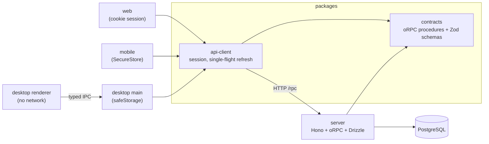
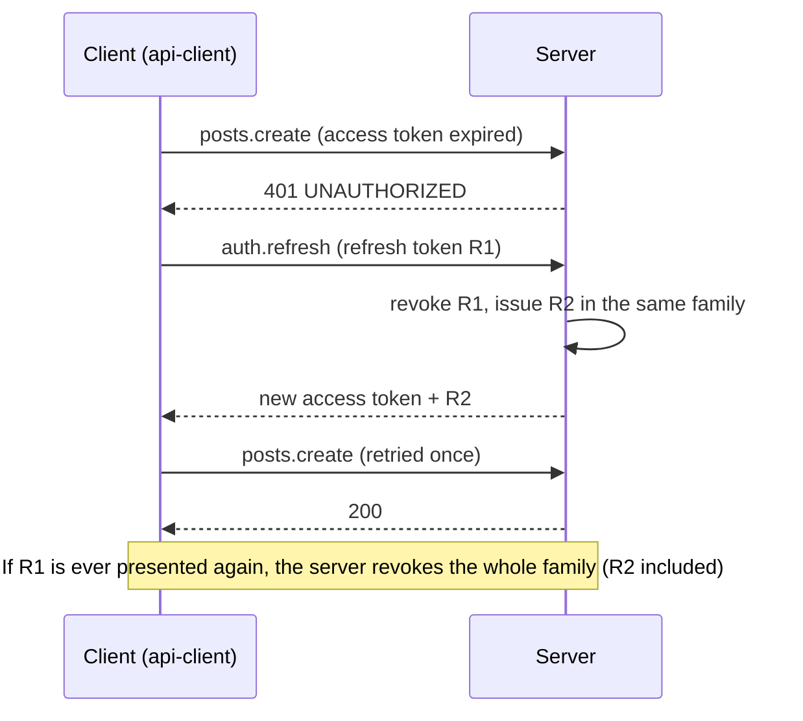

# Fullstack Monorepo Starter

[](https://github.com/wdevelope/fullstack-monorepo-starter/actions/workflows/ci.yml)
[](LICENSE)

One TypeScript contract, four apps: an API server, a web app, a desktop app and a mobile app. All of them share one typed API definition and one session client.

The sample feature is real enough to copy into production: **email/password auth with rotating refresh tokens and reuse detection**, and a **community board** (posts, comments, likes) built as one vertical slice from contract to every client.

The repo also has a **development harness** for AI-assisted work: specs with scenario IDs, test-first edit guards for Claude Code, a commit guard and CI that checks every scenario has a test.

| Layer    | Stack                                                                          |
| -------- | ------------------------------------------------------------------------------ |
| Contract | [oRPC](https://orpc.dev) contract-first API, Zod 4                             |
| Server   | Hono, oRPC, Drizzle ORM, PostgreSQL 16, Node.js type stripping (no build step) |
| Web      | Vite, React 19, TanStack Router + Query, Tailwind CSS v4                       |
| Desktop  | Electron, electron-vite, React 19, TanStack Query                              |
| Mobile   | Expo SDK 57, Expo Router, NativeWind, SecureStore                              |
| Tooling  | pnpm workspaces + catalog, Turborepo, ESLint (custom boundary rule), Vitest    |

## Architecture



- **One contract.** `packages/contracts` defines every procedure, its Zod input/output and its typed errors (`EMAIL_TAKEN`, `ACCOUNT_LOCKED { retryAfterSeconds }`, ...). The server implements it with `implement(contract)`; clients get full types and the same schemas for form validation.
- **One session client.** `packages/api-client` keeps the access token in memory, stores the refresh token where each platform keeps secrets, and refreshes **once** when several calls hit an expired token at the same time.
- **Hard boundaries.** Apps never import each other; they share code only through `packages/`. A custom ESLint rule ([`tooling/eslint/boundaries.mjs`](tooling/eslint/boundaries.mjs)) fails the build otherwise.

## Auth, done properly

| Concern              | How it is handled                                                                                                                                    |
| -------------------- | ---------------------------------------------------------------------------------------------------------------------------------------------------- |
| Password storage     | scrypt at OWASP cost (N=2¹⁷), per-user salt, constant-time compare. The cost is stored in each hash so it can rise later.                            |
| Access tokens        | 15-minute HS256 JWT. The audience is the client kind, so a web token is rejected when replayed from a native client.                                 |
| Refresh tokens       | 256-bit random, only the SHA-256 hash is stored, 14-day expiry, rotated on every use.                                                                |
| Stolen refresh token | Presenting an already-used token revokes the whole token family (reuse detection). A guarded `UPDATE` lets only one of two concurrent refreshes win. |
| Brute force          | Five consecutive failures lock the account for 15 minutes (`ACCOUNT_LOCKED` with `retryAfterSeconds`).                                               |
| User enumeration     | Unknown email and wrong password return the same error and take the same time (dummy hash check).                                                    |
| Web storage          | Refresh token in an `HttpOnly; SameSite=Strict; Path=/rpc/auth` cookie the page cannot read.                                                         |
| CSRF                 | The cookie is honoured only with the `x-client-kind: web` header, which a cross-site form cannot send.                                               |
| Native storage       | iOS Keychain / Android Keystore (SecureStore) on mobile, OS-encrypted `safeStorage` on desktop.                                                      |
| Desktop renderer     | Sandboxed, context-isolated, no network and no tokens. The main process makes every API call through a typed IPC allowlist.                          |



The full rules and scenarios are in [`docs/specs/auth.md`](docs/specs/auth.md).

## Community board

Posts, comments and likes ([`docs/specs/community.md`](docs/specs/community.md)):

- **Keyset pagination** on `(created_at, id)` with an opaque cursor, so pages stay stable while new posts arrive. Timestamps are stored at millisecond precision so cursors round-trip exactly.
- **Idempotent likes** enforced by a composite primary key with `ON CONFLICT DO NOTHING`.
- **Author-only edits** done in a single `UPDATE ... WHERE id = $1 AND author_id = $2`, then a lookup only to tell `NOT_FOUND` from `FORBIDDEN`.
- **Cascading deletes** for comments and likes.

## Development workflow

Behaviour is written down before it is built, and the tooling checks that it stays that way.

1. **Spec**: `docs/specs/<feature>.md` lists rules and scenarios with IDs (`AUTH-1` … `AUTH-17`, `COM-1` … `COM-11`).
2. **Test**: every scenario gets a test whose title starts with its ID: `it("AUTH-9 revokes the whole family when a rotated token is reused")`.
3. **Code**: the smallest change that passes.

| Guard                                              | Runs                     | Checks                                                                                                  |
| -------------------------------------------------- | ------------------------ | ------------------------------------------------------------------------------------------------------- |
| [`spec-check`](tooling/harness/spec-check.mjs)     | pre-commit, CI           | Every scenario of a `Done` spec has a test; no test names an unknown scenario                           |
| [`commit-guard`](tooling/harness/commit-guard.mjs) | pre-commit, commit-msg   | `as any`, `@ts-ignore`, `.only`, reasonless `eslint-disable`, secrets, edited migrations, commit format |
| [`edit-guard`](.claude/hooks/edit-guard.mjs)       | Claude Code `PreToolUse` | Blocks logic edits until a test in the same workspace changed; blocks secrets and committed migrations  |
| [`boundaries`](tooling/eslint/boundaries.mjs)      | ESLint                   | Apps import only `packages/*`, never each other                                                         |
| [Skills](.claude/skills)                           | Claude Code              | `spec` (write and approve a spec) and `implement` (test-first vertical slice)                           |

The guards have their own tests (`pnpm test:tooling`).

## Getting started

Requirements: Node.js 22.18+ (see `.nvmrc`), pnpm 10, Docker.

```bash
pnpm install
pnpm db:up
cp apps/server/.env.example apps/server/.env   # then set JWT_SECRET
```

```bash
pnpm --filter @starter/server db:migrate
```

```bash
pnpm dev
```

The server runs on http://localhost:3000 and the web app on http://localhost:5173 (Vite proxies `/rpc`, so the session cookie is first-party in development). Desktop and mobile have their own READMEs: [`apps/desktop`](apps/desktop/README.md), [`apps/mobile`](apps/mobile/README.md).

### Checks

```bash
pnpm lint          # ESLint (with boundary rule) + Prettier
pnpm spec:check    # specs ↔ tests
pnpm test:tooling  # tests for the guards themselves
pnpm typecheck
pnpm test          # server tests need Postgres (TEST_DATABASE_URL)
```

## Project structure

```
apps/
  server/      Hono + oRPC API, Drizzle schema and migrations, integration tests on Postgres
  web/         React web client
  desktop/     Electron client (main / preload / renderer)
  mobile/      Expo client
packages/
  contracts/   oRPC contract and Zod schemas shared by everything
  api-client/  typed client with session handling and token refresh
docs/specs/    feature specs with scenario IDs
tooling/       ESLint boundary rule, harness scripts, git hooks
.claude/       Claude Code hooks and skills
```

## Not included (yet)

Email verification, password reset, per-IP rate limiting, file uploads and browser end-to-end tests in CI. Each would start as a spec in `docs/specs`.

## License

[MIT](LICENSE)
