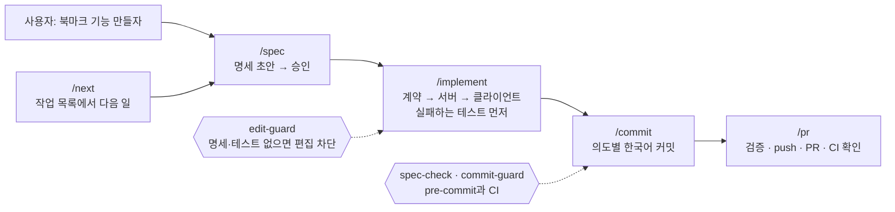
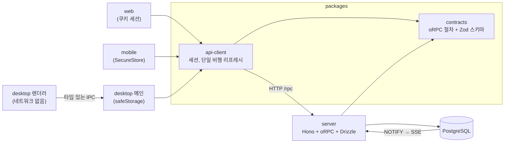
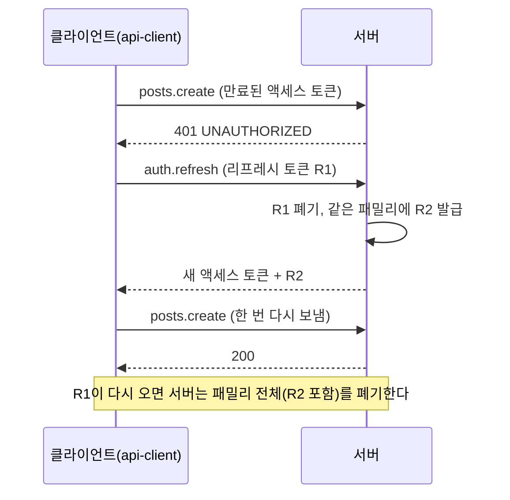

# 풀스택 모노레포 스타터

[](https://github.com/wdevelope/fullstack-monorepo-starter/actions/workflows/ci.yml)
[](LICENSE)

TypeScript 계약 하나로 네 개의 앱(API 서버, 웹, 데스크톱, 모바일)을 움직이는 모노레포입니다. 모든 앱이 같은 타입 있는 API 정의와 같은 세션 클라이언트를 씁니다.

예시 기능은 그대로 운영에 옮겨도 될 수준으로 만들었습니다. **회전하는 리프레시 토큰과 재사용 탐지를 갖춘 이메일·비밀번호 인증**, **커뮤니티 게시판**(글·댓글·좋아요), 역할과 멤버 전용 게시판이 있는 **워크스페이스**, 그리고 PostgreSQL `LISTEN/NOTIFY`로 여러 서버 인스턴스에 퍼지는 **SSE 실시간 알림**. 각각 계약에서 모든 클라이언트까지 한 번에 관통하는 수직 슬라이스입니다.

그리고 이 저장소는 **AI 에이전트와 함께 개발하도록 설계한 하네스**를 갖고 있습니다. 루트 `AGENTS.md`·`CLAUDE.md`, 앱별 규칙, 반복 절차를 담은 스킬, 그리고 규칙을 문서가 아니라 **실패하는 검사**로 강제하는 가드가 에이전트를 "명세 → 테스트 → 코드" 순서로 묶습니다.

| 레이어   | 스택                                                                          |
| -------- | ----------------------------------------------------------------------------- |
| 계약     | [oRPC](https://orpc.dev) 계약 우선 API, Zod 4                                 |
| 서버     | Hono, oRPC, Drizzle ORM, PostgreSQL 16, Node.js 타입 스트리핑(빌드 단계 없음) |
| 웹       | Vite, React 19, TanStack Router + Query, Tailwind CSS v4                      |
| 데스크톱 | Electron, electron-vite, React 19, TanStack Query                             |
| 모바일   | Expo SDK 57, Expo Router, NativeWind, SecureStore                             |
| 도구     | pnpm 워크스페이스 + catalog, Turborepo, ESLint(자체 경계 규칙), Vitest        |

## AI 에이전트 개발 하네스

에이전트는 지시를 잊거나 "일단 돌아가게" 고치기 쉽습니다. 이 저장소는 규칙을 세 층으로 나눠 필요한 맥락만 읽히고, 어긴 순간 기계적으로 막습니다.

```
AGENTS.md                  모든 에이전트 공통 규칙(정본). Codex·Cursor 등도 읽는다
CLAUDE.md                  @AGENTS.md를 불러오고 Claude Code 전용(스킬·훅·권한)만 더한다
.claude/
  rules/                   앱별 규칙. 해당 경로의 파일을 다룰 때만 자동으로 읽힌다
    server.md web.md desktop.md mobile.md packages.md
  skills/                  반복 절차. 사용자의 말에 맞춰 자동으로 실행된다
    spec/ implement/ commit/ next/ pr/
  hooks/edit-guard.mjs     편집 전 검사(명세 먼저, 테스트 먼저, 비밀값, 마이그레이션)
  settings.json            훅 등록, 비밀값·생성물 편집 금지
docs/
  specs/                   기능 명세. 시나리오 ID가 테스트 제목이 된다
  DECISIONS.md             설계 결정 기록(D1~D14)
  plans/00-작업목록.md      남은 일. /next가 여기서 고른다
tooling/harness/           spec-check, commit-guard (CI와 git 훅에서 실행)
```

### 일하는 흐름



| 스킬         | 이렇게 말하면                                   | 하는 일                                                               |
| ------------ | ----------------------------------------------- | --------------------------------------------------------------------- |
| `/spec`      | "북마크 기능 만들자", "이 동작 바꾸자"          | 명세 초안을 쓰고, 미결 질문을 묻고, 명시적 승인을 받는다              |
| `/implement` | 승인된 명세를 만들 때                           | 시나리오마다 Red → Green → Refactor로 계약·서버·클라이언트를 관통한다 |
| `/commit`    | "커밋해줘", "나눠서 커밋해줘"                   | 변경을 의도별로 나눠 `type(scope): 한글 요약`으로 경로 지정 커밋한다  |
| `/next`      | "남은 작업 뭐야?", "다음 진행해", "나중에 하자" | 작업 목록에서 한 항목을 골라 끝까지 하거나 목록에 더한다              |
| `/pr`        | "PR 올려줘"                                     | 전역 검증 후 push하고 한국어 PR을 만든 뒤 CI 결과를 확인한다          |

### 규칙을 검사로 만든다

| 가드                                               | 언제                   | 막는 것                                                                                                     |
| -------------------------------------------------- | ---------------------- | ----------------------------------------------------------------------------------------------------------- |
| [`edit-guard`](.claude/hooks/edit-guard.mjs)       | Claude Code 편집 직전  | **명세 없는 소스**(승인된 명세의 코드 경로 밖), **테스트 변경 없는 로직 수정**, 비밀값, 커밋된 마이그레이션 |
| [`spec-check`](tooling/harness/spec-check.mjs)     | pre-commit, CI         | 명세 머리말 형식, 테스트 없는 완료 시나리오, 없는 시나리오를 부르는 테스트, 어느 명세도 덮지 않는 소스 파일 |
| [`commit-guard`](tooling/harness/commit-guard.mjs) | pre-commit, commit-msg | `as any`·`@ts-ignore`, `.only`, 이유 없는 `eslint-disable`, 비밀값, 마이그레이션 수정, 커밋 제목 형식       |
| [`boundaries`](tooling/eslint/boundaries.mjs)      | ESLint                 | 앱끼리의 import(공유는 `packages/`로만)                                                                     |

가드도 테스트가 있습니다(`pnpm test:tooling`). 막힐 때의 메시지는 에이전트가 읽고 바로 올바른 순서로 돌아오도록 "무엇을 하면 되는지"를 한국어로 말합니다. 예를 들어 명세 없이 새 기능 폴더를 만들려 하면:

```
명세 먼저: apps/server/src/features/bookmarks/bookmarks.service.ts를 덮는 승인·완료 명세가 docs/specs에 없다.
기존 기능의 파일이면 그 명세의 코드 경로에 더한다(시나리오가 그대로면 승인 없이 고치고 보고한다).
새 기능이면 spec 스킬로 명세 초안을 쓰고 사용자 승인을 받은 뒤 만든다.
```

### 명세와 테스트의 연결

명세(`docs/specs/*.md`)는 상태(`초안` → `승인` → `완료`), ID 접두, 코드 경로, 시나리오 표를 가집니다. 테스트 제목은 시나리오 ID로 시작합니다.

```ts
it("AUTH-9 이미 회전한 리프레시 토큰이 다시 오면 패밀리 전체를 폐기한다", async () => { ... });
```

명세 7개, 시나리오 82개가 모두 테스트와 연결돼 있습니다: 인증 `AUTH-1~20`, 요청 횟수 제한 `RATE-1~10`, 커뮤니티 `COM-1~11`, 워크스페이스 `WS-1~11`, 알림 `NOTI-1~10`, 데스크톱 보안 `DESK-1~15`, 공통 기반 `PLAT-1~5`. 핵심 흐름(가입 AUTH-1, 글쓰기 COM-5, 두 사용자 사이의 실시간 알림 NOTI-6)은 CI에서 실제 서버·DB·브라우저로 도는 Playwright E2E로도 확인합니다([`apps/web/e2e`](apps/web/e2e)).

## 아키텍처



- **계약 하나.** `packages/contracts`가 모든 절차, 그 Zod 입력·출력, 타입 있는 오류(`EMAIL_TAKEN`, `ACCOUNT_LOCKED { retryAfterSeconds }` …)를 정의합니다. 서버는 `implement(contract)`로 구현하고, 클라이언트는 완전한 타입과 같은 폼 검증 스키마를 얻습니다([D1](docs/DECISIONS.md)).
- **세션 클라이언트 하나.** `packages/api-client`는 액세스 토큰을 메모리에 두고, 리프레시 토큰은 플랫폼마다 비밀을 두는 곳에 저장하며, 여러 호출이 동시에 만료된 토큰을 만나도 리프레시는 **한 번만** 합니다(D5).
- **단단한 경계.** 앱은 서로 import하지 않고 `packages/`로만 코드를 공유합니다. 자체 ESLint 규칙이 어기면 빌드를 실패시킵니다.

## 제대로 만든 인증

| 관심사               | 처리 방법                                                                                                                                                                                                                                                             |
| -------------------- | --------------------------------------------------------------------------------------------------------------------------------------------------------------------------------------------------------------------------------------------------------------------- |
| 비밀번호 저장        | OWASP 비용(N=2¹⁷)의 scrypt, 사용자별 솔트, 상수 시간 비교. 비용을 해시에 함께 저장해 나중에 올릴 수 있다.                                                                                                                                                             |
| 액세스 토큰          | 15분짜리 HS256 JWT. audience가 클라이언트 종류라서 웹 토큰을 네이티브 클라이언트로 재생하면 거부된다.                                                                                                                                                                 |
| 리프레시 토큰        | 256비트 난수, SHA-256 해시만 저장, 14일 만료, 쓸 때마다 회전.                                                                                                                                                                                                         |
| 탈취된 리프레시 토큰 | 이미 쓴 토큰이 다시 오면 토큰 패밀리 전체를 폐기(재사용 탐지). 조건부 `UPDATE`로 동시 리프레시 두 개 중 하나만 이긴다.                                                                                                                                                |
| 무차별 대입          | 다섯 번 연속 실패하면 15분 잠금(`ACCOUNT_LOCKED`). 여러 계정을 노리는 대입은 IP 단위 요청 제한(로그인 1분 10회, 가입 1시간 10회, 리프레시 1분 30회, `TOO_MANY_REQUESTS`)이 막는다. 카운터는 PostgreSQL UPSERT 한 문이라 서버가 여러 대여도, 동시 요청이어도 정확하다. |
| 사용자 열거          | 없는 이메일과 틀린 비밀번호는 같은 오류를 같은 시간에 돌려준다(더미 해시 검사).                                                                                                                                                                                       |
| 웹 저장소            | 리프레시 토큰은 페이지가 읽을 수 없는 `HttpOnly; SameSite=Strict; Path=/rpc/auth` 쿠키에.                                                                                                                                                                             |
| CSRF                 | 쿠키는 `x-client-kind: web` 헤더가 있을 때만 쓴다. 다른 사이트의 폼은 이 헤더를 보낼 수 없다.                                                                                                                                                                         |
| 네이티브 저장소      | 모바일은 iOS Keychain / Android Keystore(SecureStore), 데스크톱은 OS가 암호화하는 `safeStorage`.                                                                                                                                                                      |
| 데스크톱 렌더러      | 샌드박스, 컨텍스트 격리, 네트워크·토큰 없음. 모든 API 호출은 메인 프로세스가 타입 있는 IPC 허용 목록을 거쳐 한다.                                                                                                                                                     |



전체 규칙과 시나리오는 [`docs/specs/auth.md`](docs/specs/auth.md)에 있습니다.

## 커뮤니티 게시판

글, 댓글, 좋아요([`docs/specs/community.md`](docs/specs/community.md)):

- `(created_at, id)` **키셋 페이지네이션**과 불투명 커서. 새 글이 들어와도 페이지가 밀리지 않는다. 커서가 정확히 오가도록 타임스탬프는 밀리초 정밀도로 저장한다(D8).
- **멱등 좋아요**: 복합 기본 키와 `ON CONFLICT DO NOTHING`.
- **작성자만 수정**: `UPDATE ... WHERE id = $1 AND author_id = $2` 한 문으로 하고, 실패했을 때만 조회해 `NOT_FOUND`와 `FORBIDDEN`을 가른다.
- 글을 지우면 댓글과 좋아요도 **연쇄 삭제**.

## 워크스페이스

`owner`, `admin`, `member` 역할이 있는 팀 비공개 게시판([`docs/specs/workspaces.md`](docs/specs/workspaces.md)):

- **리소스 단위 인가.** 모든 읽기·쓰기가 호출자의 멤버십을 같은 SQL 문 안의 `EXISTS`로 확인한다(`INSERT ... SELECT`, `UPDATE/DELETE ... WHERE EXISTS`). 확인과 실행 사이의 틈이 없고, 멤버를 내보내는 순간 접근이 끝난다(D7).
- **존재를 드러내지 않는다.** 멤버가 아니면 워크스페이스, 글 목록, 글, 댓글, 좋아요 모두 `FORBIDDEN`이 아니라 `NOT_FOUND`.
- **모더레이션.** 관리자와 소유자는 그 워크스페이스에서 누구의 글·댓글이든 지울 수 있다. 수정은 작성자만. 워크스페이스당 소유자 하나는 부분 고유 인덱스가 강제한다.

## 실시간 알림

내 글에 달린 댓글과 좋아요가 읽지 않은 개수와 함께 알림함에 쌓이고, 열려 있는 모든 클라이언트가 실시간으로 받습니다([`docs/specs/notifications.md`](docs/specs/notifications.md)):

```mermaid
sequenceDiagram
  participant B as Bob의 클라이언트
  participant S1 as 서버 인스턴스 1
  participant PG as PostgreSQL
  participant S2 as 서버 인스턴스 2
  participant A as Alice의 클라이언트
  A->>S2: notifications.stream (SSE, 액세스 토큰)
  S2->>PG: LISTEN notifications (인스턴스당 연결 하나, 시작할 때)
  S2-->>A: ready { unreadCount }
  B->>S1: comments.create
  S1->>PG: BEGIN; INSERT comment; INSERT notification; SELECT pg_notify(...); COMMIT
  PG-->>S1: NOTIFY { id, recipientId }
  PG-->>S2: NOTIFY { id, recipientId }
  S2->>PG: 알림 조회 WHERE id AND recipient = Alice
  S2-->>A: notification { ..., unreadCount }
  Note over S2,A: 액세스 토큰이 만료되면 스트림이 끝나고, 클라이언트가 리프레시 후 다시 연결한다
```

- **같은 트랜잭션.** 알림은 댓글·좋아요와 함께 쓴다. `pg_notify`는 트랜잭션 안에서 부르고 PostgreSQL은 커밋 뒤에만 전달하므로, 롤백된 행에 대한 알림이 나가지 않는다(D9).
- **어느 인스턴스든.** 서버 프로세스마다 `LISTEN` 연결 하나를 두고([`notification-hub.ts`](apps/server/src/platform/notification-hub.ts)) 받는 사람별로 자기 인스턴스의 열린 스트림에 나눠 준다.
- **세션에 묶인 스트림.** 스트림은 액세스 토큰 만료 때 끝난다. `@starter/api-client`의 `watchNotifications`가 한 번 리프레시하고 다시 열며, 네트워크 오류에는 백오프로 재시도한다. 폐기된 세션은 토큰 수명 안에 수신이 멈춘다.
- **클라이언트.** 웹은 실시간 알림 종, 데스크톱은 메인 프로세스가 스트림을 갖고 IPC로 넘기며 시스템 알림을 띄운다. 모바일은 화면에 들어올 때 알림함과 배지를 다시 읽는다(아직 실시간 스트림 없음, D13).

## 시작하기

필요한 것: Node.js 22.18+(`.nvmrc`), pnpm 10, Docker.

```bash
pnpm install
pnpm db:up
cp apps/server/.env.example apps/server/.env   # JWT_SECRET을 채운다
```

```bash
pnpm --filter @starter/server db:migrate
```

```bash
pnpm dev
```

서버는 http://localhost:3000, 웹은 http://localhost:5173에서 돕니다(Vite가 `/rpc`를 프록시하므로 개발 중에도 세션 쿠키가 같은 출처입니다). 데스크톱과 모바일은 각자의 README를 보세요: [`apps/desktop`](apps/desktop/README.md), [`apps/mobile`](apps/mobile/README.md).

### 검사

```bash
pnpm lint          # ESLint(경계 규칙 포함) + Prettier
pnpm spec:check    # 명세 ↔ 테스트 ↔ 코드 경로
pnpm test:tooling  # 가드 자체의 테스트
pnpm typecheck
pnpm test          # 서버 테스트는 PostgreSQL이 필요하다(TEST_DATABASE_URL)
pnpm --filter @starter/web test:e2e   # 브라우저 E2E: 서버·웹을 띄워 가입 → 글쓰기 → 실시간 알림까지 확인
```

## 프로젝트 구조

```
apps/
  server/      Hono + oRPC API, Drizzle 스키마와 마이그레이션, PostgreSQL 통합 테스트
  web/         React 웹 클라이언트
  desktop/     Electron 클라이언트(main / preload / renderer)
  mobile/      Expo 클라이언트
packages/
  contracts/   모든 앱이 공유하는 oRPC 계약과 Zod 스키마
  api-client/  세션 관리와 토큰 리프레시를 가진 타입 있는 클라이언트
docs/
  specs/       시나리오 ID가 있는 기능 명세
  DECISIONS.md 설계 결정 기록
  plans/       작업 목록
tooling/       ESLint 경계 규칙, 하네스 스크립트, git 훅
AGENTS.md      에이전트 공통 규칙
CLAUDE.md      Claude Code 전용 설정(스킬·훅)
.claude/       앱별 규칙, 스킬, 훅
```

## 범위 밖

비밀번호 재설정, 이메일 인증, 파일 업로드, 모바일 푸시 알림은 메일·스토리지·푸시 같은 외부 인프라가 있어야 시연할 수 있어 이 저장소의 범위에서 뺐습니다. 필요해지면 명세부터 시작합니다. 남은 개선 작업은 [`docs/plans/00-작업목록.md`](docs/plans/00-작업목록.md)에 있습니다.

## 라이선스

[MIT](LICENSE)
